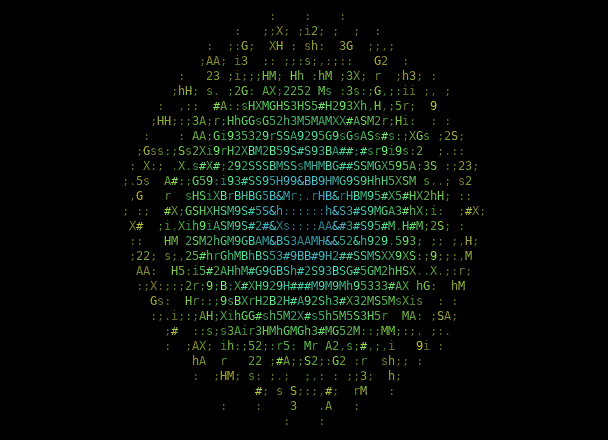

# Oh My Zsh Shellsaver adapter

This directory contains a thin Zsh launcher for the canonical `mandalac`
animation. It does not contain a second renderer: `mandala.zsh` resolves the
project executable and replaces itself with `mandala --shellsaver`.

## Boundary

The C application remains the only source of truth for the 240 E8 roots,
eight-dimensional motion, Coxeter-plane projection, density rendering, color,
timing, input handling, resize handling, and terminal restoration. Shellsaver
mode:

- renders the same live E8 geometry as the standalone application;
- uses the entire terminal and exits on any key;
- accepts an optional `--seconds N` timeout;
- preserves the existing 2,000,000-cell memory bound; and
- restores the cursor, terminal attributes, and alternate screen on exit.

The launcher adds no per-frame processes, duplicated geometry, or rendering
overhead.

## Local validation

```sh
make
MANDALAC_BIN=$PWD/mandala zsh contrib/oh-my-zsh/mandala.zsh --seconds 30
make test-omz
```

The executable is resolved in this order: `MANDALAC_BIN`, the repository-local
`mandala` binary, then an installed `mandalac` or `mandala` command.
`MANDALAC_BIN` is the unambiguous integration contract and is recommended for
packaging.



## Upstream integration status

Oh My Zsh Shellsavers currently has built-in scenes but no stable external
scene-provider interface. The launcher is therefore the compatibility boundary
and a concrete executable-provider example. An upstream integration would need
to dispatch to this executable before the current in-process renderer takes
ownership of the terminal.

This visual shellsaver is not a security lock.

[shellsavers]: https://github.com/ohmyzsh/ohmyzsh/pull/14167
